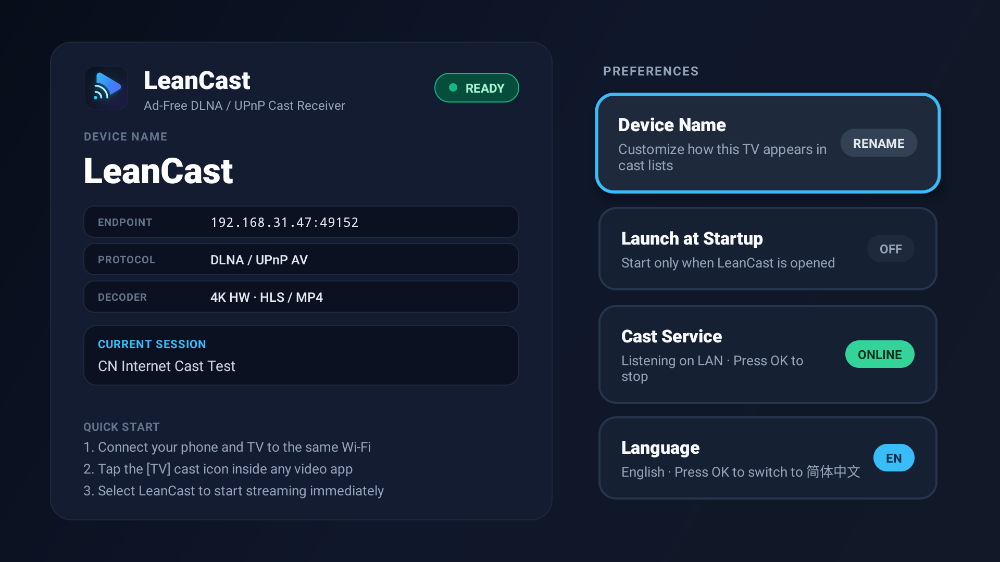
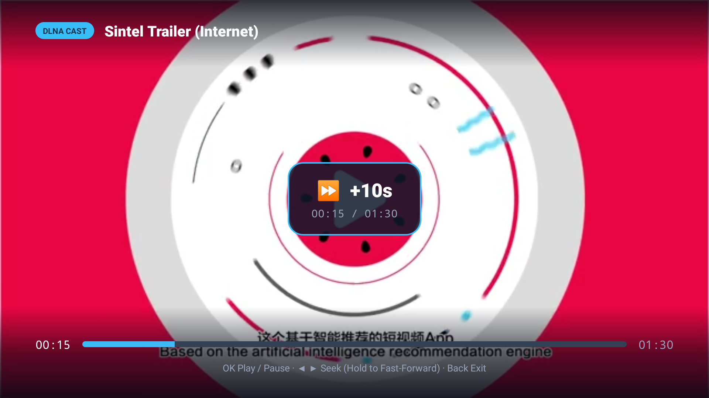

# LeanCast

English | [简体中文](README.zh-CN.md)

<p align="center">
  
  
</p>

A minimal, ad-free **DLNA/UPnP cast receiver** for Android TV. Open any video app
with a cast button (Bilibili, iQiyi, Tencent Video, Youku, Quark, …), pick this
receiver, and the video plays fullscreen with hardware decoding — no ads, no
accounts, no cloud.

```
Phone app --SSDP--> discovers  Phone app --SOAP SetAVTransportURI--> LeanCast
                                                                    |
                                                        ExoPlayer + MediaCodec HW decode
```

## Highlights

- **Standard UPnP AV `MediaRenderer:1`** — SSDP discovery, AVTransport /
  RenderingControl / ConnectionManager SOAP control, GENA subscribe stubs.
- **Hardware decoding** via Media3/ExoPlayer: HLS (`.m3u8`), progressive MP4,
  Matroska, HTTP-FLV (best effort), HTTP↔HTTPS redirects, cleartext LAN URLs.
- **TV-native controls & OSD**: OK = pause/resume, ◀ ▶ = seek with an
  **escalating fast-forward ladder (10 s → 5 min while held)**, Back = exit;
  on-screen HUD with live progress bar, media title, and seek-step feedback in
  English or Chinese.
- **Lean & private**: lighter than the stock TV launcher (see below); zero
  analytics, zero non-LAN network calls; pure-Kotlin APK with **no native
  libs** — one artifact runs on `armeabi-v7a`, `arm64-v8a`, `x86`, `x86_64`.
- **Nothing hardcoded**: the cast name defaults to `LeanCast` and is
  user-renamable; UUID persists across reboots; UI language switchable between
  简体中文 and English.
- Tested on an Amazon Fire TV (Fire OS 7 / Android 9, 32-bit MTK SoC) with
  `minSdk 21` / `targetSdk 28`.

## Build

Requirements: JDK 17+, Android SDK (platform 34). Then:

```bash
./gradlew assembleDebug
# app/build/outputs/apk/debug/app-debug.apk
```

## Install & use

```bash
adb connect <TV-IP>:5555
adb install -r app/build/outputs/apk/debug/app-debug.apk
adb shell am start -n io.leancast/io.leancast.app.MainActivity
```

Launch the app once to start the receiver service; it then appears in every
DLNA sender's device list under the receiver name (rename it in the app).
Optional: enable **Start on boot** in the app.

## Supported devices

LeanCast is a pure-Kotlin APK with **no native libraries** and `minSdk 21`
(Android 5.0, 2014), so a single artifact covers `armeabi-v7a`, `arm64-v8a`,
`x86` and `x86_64`. Decoding uses each device's platform `MediaCodec`, so codec
coverage follows the device: H.264 everywhere, HEVC/4K on 2016+ TVs, AV1 only
on newer boxes.

| Tier | Devices | Notes |
| :--- | :--- | :--- |
| ✅ Verified | Amazon Fire TV / Fire TV Stick (Fire OS 6/7) | Primary test device: Fire OS 7.7, 32-bit MTK SoC |
| ✅ Expected | Certified Android TV / Google TV (Sony, TCL, Philips, Chromecast w/ Google TV), NVIDIA Shield, Amlogic / Rockchip boxes, Xiaomi international boxes | Sideload and go |
| ⚠️ Experimental | CN smart TVs with sideloading (MIUI TV / PatchWall, Coocaa, Hisense Android models), Tmall boxes (YunOS) | Enable "unknown sources"; report results via the compatibility issue template |
| ❌ Unsupported | Samsung (Tizen), LG (webOS), Huawei Vision (HarmonyOS), non-smart TVs | No Android app runtime — use any TV box from the ✅ tiers |

Notes:
- Phone "system cast" (Miracast) is out of scope — LeanCast is a DLNA/UPnP
  receiver, so use the `[TV]` button inside video apps.
- Tested an unlisted device? Open a **Device compatibility report** issue and
  help grow the matrix.

## Resource usage

Measured on the primary test device (Fire TV, 1.6 GB RAM); idle = receiver
waiting on the dashboard:

| State | RAM (PSS) | CPU | Storage |
| :--- | :--- | :--- | :--- |
| Idle / waiting | 63–72 MB (≈ 33 MB private) | ≈ 0% | 5 MB APK + < 0.1 MB data |
| Casting 1080p | ≈ 74 MB | ~4–5% of total (decode is hardware) | — |

Lighter than the stock Fire TV launcher (83 MB PSS) on the same device.

## Releases & CI

Two GitHub Actions workflows ship with the repo:

- **CI** (`.github/workflows/ci.yml`) — runs domain unit tests + debug build on
  every push to `main` and every PR; uploads the debug APK as an artifact.
- **Release** (`.github/workflows/release.yml`) — triggered by pushing a `v*`
  tag (or manually via *workflow_dispatch*). Builds the release APK, runs the
  unit tests, creates a GitHub Release with auto-generated notes, and attaches
  `LeanCast-<version>.apk`.

To publish a release:

```bash
git tag v0.2.0
git push origin v0.2.0
```

### Release signing

By default the release APK falls back to the debug keystore (fine for personal
sideloading). For a stable release signature across builds, add these
repository secrets (**Settings → Secrets and variables → Actions**):

| Secret | Value |
| :--- | :--- |
| `KEYSTORE_BASE64` | `base64 -i release.keystore \| pbcopy` (or `base64 -w0` on Linux) |
| `KEYSTORE_PASSWORD` | Keystore password |
| `KEY_ALIAS` | Key alias |
| `KEY_PASSWORD` | Key password |

The workflow decodes the keystore to `ci-release.keystore` (git-ignored) and
signs with it. Generate a keystore once with:

```bash
keytool -genkeypair -v -keystore release.keystore -alias leancast \
  -keyalg RSA -keysize 2048 -validity 10000
```

## Project layout

```
domain/          Pure-Kotlin protocol core (JVM-unit-tested, 90 tests)
  ssdp/          M-SEARCH parsing, target matching, USN, alive/byebye, MX delays
  upnp/          Device description + SCPDs, SOAP parser (prefix-tolerant DIDL),
                 response envelopes & faults, H:MM:SS time math, SOAP router
  cast/          AVTransport state machine, player port, volume math
app/             Android shell (thin adapters, E2E-verified on device)
  ControlServer  NanoHTTPD: /desc.xml, /scpd/*, /ctl/*, /evt/*
  SsdpAgent      Multicast UDP listener + advertiser (MulticastLock held)
  ExoPlayerPort  PlayerPort adapter (main-thread marshalled, cached position)
  ReceiverService Foreground service assembling everything
tools/
  e2e_control_point.py  Scripted UPnP control point for device E2E runs
openspec/        Spec-driven development artifacts (proposal/specs/design/tasks)
```

Development follows **OpenSpec** (`openspec/`) with strict TDD: every spec
scenario maps to unit tests in `domain`; run them with `./gradlew :domain:test`.
End-to-end verification drives a real device from a dev box:

```bash
python3 tools/e2e_control_point.py http://<lan-host>/video.mp4
```

## License

Apache-2.0. Dependencies: NanoHTTPD (BSD-3), Media3 (Apache-2.0).
