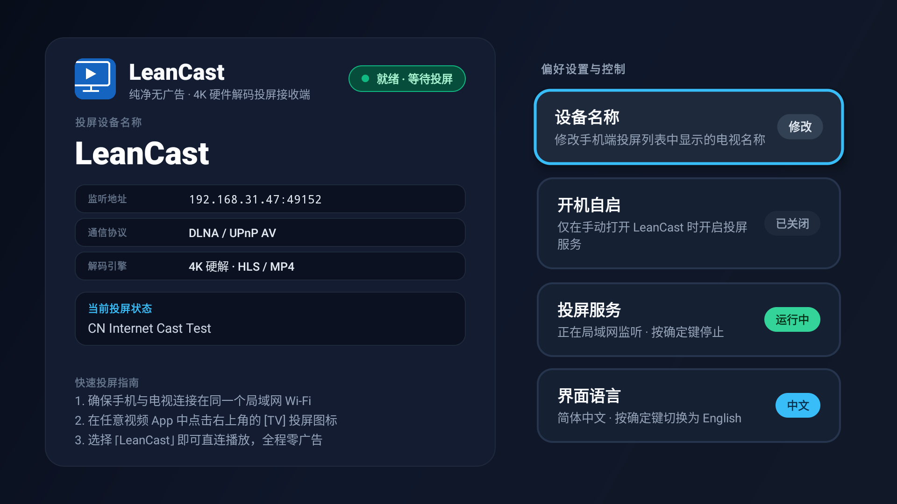
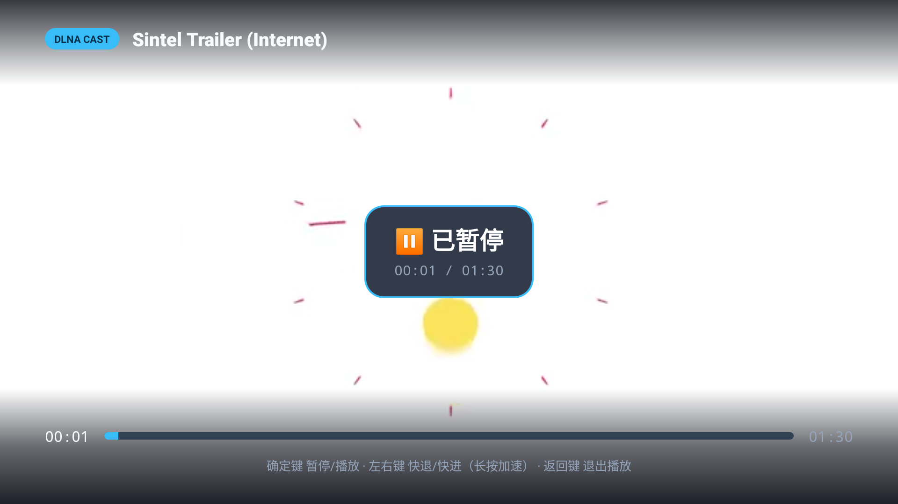

# LeanCast

[English](README.md) | 简体中文

<p align="center">
  
  
</p>

一个极简、无广告的 Android TV **DLNA/UPnP 投屏接收器**。在任意带投屏按钮的视频 App（B站、爱奇艺、腾讯视频、优酷、夸克等）中点击 [TV]，选择本机即可全屏硬解播放——没有广告、无需账号、不连云端。

```
手机 App --SSDP--> 发现设备    手机 App --SOAP SetAVTransportURI--> LeanCast
                                                                  |
                                                      ExoPlayer + MediaCodec 硬件解码
```

## 特性

- **标准 UPnP AV `MediaRenderer:1`** — SSDP 设备发现、AVTransport / RenderingControl / ConnectionManager SOAP 控制、GENA 订阅桩。
- **硬件解码**（Media3/ExoPlayer）：HLS（`.m3u8`）、渐进式 MP4、Matroska、HTTP-FLV（尽力支持）、HTTP↔HTTPS 重定向、局域网明文地址。
- **TV 原生操控与 OSD**：OK 键 暂停/继续，◀ ▶ 长按**阶梯加速快进（10 秒 → 5 分钟）**，返回键 退出；屏上 HUD 实时进度条、片名与快进步长反馈，支持中英文。
- **轻量且保护隐私**：比电视自带桌面还省内存（见下表）；零埋点、除局域网外零网络请求；纯 Kotlin APK **无任何原生库**——一个安装包通吃 `armeabi-v7a`、`arm64-v8a`、`x86`、`x86_64`。
- **零硬编码**：投屏名称默认 `LeanCast`，可随时改名；UUID 重启保持不变；界面语言可在简体中文与 English 间切换。
- 已在 Amazon Fire TV（Fire OS 7 / Android 9，32 位 MTK SoC）上实测，`minSdk 21` / `targetSdk 28`。

## 构建

要求：JDK 17+、Android SDK（platform 34）。

```bash
./gradlew assembleDebug
# app/build/outputs/apk/debug/app-debug.apk
```

## 安装与使用

```bash
adb connect <TV-IP>:5555
adb install -r app/build/outputs/apk/debug/app-debug.apk
adb shell am start -n io.leancast/io.leancast.app.MainActivity
```

打开一次应用即可启动接收服务，之后手机视频 App 的投屏设备列表中会出现本机（可在应用内改名）。可选：在应用内开启「开机自动启动」。

## 支持的设备

LeanCast 是**无原生库**的纯 Kotlin APK，`minSdk 21`（Android 5.0，2014 年），一个安装包覆盖 `armeabi-v7a`、`arm64-v8a`、`x86`、`x86_64`。解码使用设备自身的 `MediaCodec`，因此编解码能力跟随设备：H.264 全员支持，HEVC/4K 需 2016 年后的电视，AV1 仅较新的盒子支持。

| 层级 | 设备 | 说明 |
| :--- | :--- | :--- |
| ✅ 已验证 | Amazon Fire TV / Fire TV Stick（Fire OS 6/7） | 主要测试设备：Fire OS 7.7，32 位 MTK SoC |
| ✅ 预期兼容 | 认证 Android TV / Google TV（索尼、TCL、飞利浦、Chromecast w/ Google TV）、NVIDIA Shield、Amlogic / Rockchip 方案盒子、小米国际版盒子 | 侧载即用 |
| ⚠️ 实验性 | 可侧载的国产智能电视（MIUI TV / PatchWall、酷开、海信安卓机型）、天猫魔盒（YunOS） | 需开启「未知来源安装」；欢迎通过兼容性 Issue 反馈结果 |
| ❌ 不支持 | 三星（Tizen）、LG（webOS）、华为智慧屏（HarmonyOS）、非智能电视 | 无 Android 应用运行时——请搭配 ✅ 层级的电视盒子 |

说明：
- 手机「系统投屏」（Miracast）不在本项目范畴——LeanCast 是 DLNA/UPnP 接收器，请在视频 App 内使用 `[TV]` 按钮。
- 实测了列表之外的设备？欢迎提交 **Device compatibility report** Issue，一起完善支持矩阵。

## 资源占用

以下为实测数据（主测试设备 Fire TV，1.6GB 内存；空闲 = 停留在主界面待命）：

| 状态 | 内存 (PSS) | CPU | 存储 |
| :--- | :--- | :--- | :--- |
| 空闲待命 | 63–72 MB（私有约 33 MB） | ≈ 0% | 安装包 5 MB + 数据 < 0.1 MB |
| 播放 1080p | ≈ 74 MB | 全机约 4–5%（解码走硬件） | — |

同一设备上比 Fire TV 自带桌面（83 MB PSS）更省。

## 版本发布与 CI

仓库内置两个 GitHub Actions 工作流：

- **CI**（`.github/workflows/ci.yml`）— 每次 push 到 `main` 和每个 PR 自动运行 domain 单元测试 + debug 构建，并上传 debug APK 产物。
- **Release**（`.github/workflows/release.yml`）— 推送 `v*` 标签（或手动 workflow_dispatch）触发：构建 release APK、运行单元测试、创建带自动变更说明的 GitHub Release，并附上 `LeanCast-<版本号>.apk`。

发布新版本：

```bash
git tag v0.2.0
git push origin v0.2.0
```

### 发布签名

默认情况下 release APK 回退使用 debug keystore（个人侧载足够）。如需跨版本稳定的发布签名，请在仓库中配置以下 Secrets（**Settings → Secrets and variables → Actions**）：

| Secret | 值 |
| :--- | :--- |
| `KEYSTORE_BASE64` | `base64 -i release.keystore \| pbcopy`（Linux 用 `base64 -w0`） |
| `KEYSTORE_PASSWORD` | keystore 密码 |
| `KEY_ALIAS` | key 别名 |
| `KEY_PASSWORD` | key 密码 |

工作流会把 keystore 解码为 `ci-release.keystore`（已被 git 忽略）并用其签名。生成 keystore：

```bash
keytool -genkeypair -v -keystore release.keystore -alias leancast \
  -keyalg RSA -keysize 2048 -validity 10000
```

## 项目结构

```
domain/          纯 Kotlin 协议核心（JVM 单元测试，90 个用例）
  ssdp/          M-SEARCH 解析、目标匹配、USN、alive/byebye、MX 延迟
  upnp/          设备描述 + SCPD、SOAP 解析器（宽容 DIDL）、响应与故障、
                 H:MM:SS 时间换算、SOAP 路由
  cast/          AVTransport 状态机、播放器端口、音量数学
app/             Android 壳层（薄适配层，真机 E2E 验证）
  ControlServer  NanoHTTPD：/desc.xml、/scpd/*、/ctl/*、/evt/*
  SsdpAgent      组播 UDP 监听 + 通告（持有 MulticastLock）
  ExoPlayerPort  PlayerPort 适配器（主线程封装、位置缓存）
  ReceiverService  组装一切的前台服务
tools/
  e2e_control_point.py  脚本化 UPnP 控制点，用于真机 E2E
openspec/        规格驱动开发产物（proposal/specs/design/tasks）
```

开发流程遵循 **OpenSpec**（`openspec/`）+ 严格 TDD：每条规格场景都映射到
`domain` 中的单元测试，运行 `./gradlew :domain:test`。端到端验证由开发机
驱动真机完成：

```bash
python3 tools/e2e_control_point.py http://<局域网主机>/video.mp4
```

## 许可证

Apache-2.0。依赖：NanoHTTPD（BSD-3）、Media3（Apache-2.0）。
